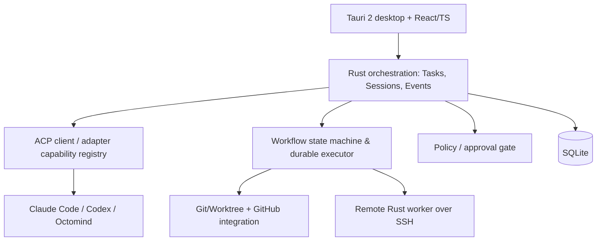

# Technical Architecture

Status: Proposed; implementation may refine these interfaces.

## Component boundaries



The UI does not launch arbitrary shell commands. It calls typed Rust commands. All tool execution, approvals, task scopes and session transitions are mediated by the relevant backend boundary.

## Runtime split

**External ACP agents:** Claude Code, Codex, Octomind, etc. remain owners of their proprietary/native prompt loops, model usage, context, internal tools and authentication. ACP capabilities are negotiated per adapter; no promise to override opaque model routing.

**AgentDock orchestration:** project/worktree selection, task history, UI timeline, approvals for host-controlled operations, independent review, CI flow, work scheduling and remote connectivity.

**Optional native agent:** future extension only if ACP agents cannot satisfy cost routing/observability; never a prerequisite for the MVP.

## Rust module plan (initial)

- `apps/desktop`: Tauri host, typed IPC, window lifecycle.
- `crates/core`: domain IDs, task/session lifecycle, event bus.
- `crates/acp`: ACP client, subprocess supervision, adapter capability detection.
- `crates/store`: SQLite schema migrations, events, approvals, checkpoint references.
- `crates/policy`: operation classification and mandatory approval gates.
- `crates/integrations`: Git and GitHub wrappers, careful command construction.
- `packages/ui`: React shell, session timeline, diffs and approvals.
- `apps/worker`: later remote worker.

Crate boundaries remain provisional: start with the fewest practical modules, split after real use.

## Data entities

| Entity | Fields (initial contract) |
| --- | --- |
| `Project` | id, name, local_path, remote_origin, environment_id |
| `Task` | id, project_id, objective, state, issue_url, branch, worktree |
| `Session` | id, task_id, adapter_id, external_session_id?, capability_snapshot, state |
| `Event` | id, task_id, session_id?, kind, created_at, payload_redacted |
| `Approval` | id, task_id, operation_fingerprint, scope, result, expires_at |
| `Check` | id, task_id, name, command, exit_code, artifact_path, state |
| `Usage` | id, session_id, provider, model, input/output/cache_tokens?, estimated_cost?, source |

`Task != Session`. Multiple implementation/review/repair sessions may belong to one task.

## Task state machine

```text
Queued → Preparing → Running → Verifying → Review → PR → CI → Complete
                          ↘ AwaitingApproval → Running
                ↘ Interrupted / Failed / Cancelled / Paused
```

- Persist state transitions before reporting completion.
- A tool with side effects must have a stable fingerprint/idempotency handling.
- Never automatically replay `git push`, PR creation, merges, database writes or destructive commands after a crash.
- Separate **history restore**, **agent reattach** (adapter-dependent) and **task resume**.

## ACP protocol boundaries

ACP stable v1 is the first target; v2 was published as a draft in July 2026. Negotiate features rather than assuming version-specific resume semantics. Consult the official Rust SDK and compatibility kit.

- Launch scoped agent process with sanitized environment.
- JSON-RPC initialize, capability discovery, authentication prompt handoff, session/new, prompt/update, cancel; session/load only when advertised.
- Never pass API tokens through the UI event log.
- Apply backpressure and bounded event retention; prevent infinite streaming.
- Provide a mock ACP agent for deterministic CI.

## Security model

- Tauri capabilities narrow the frontend exposure; **custom Rust commands still must enforce authorization**.
- Explicit workspace path checks (including symlink resolution), process environment allowlist, no secret logging.
- Approval for push/merge/destructive config/branch operations. No implicit approval from an LLM message.
- Permissions and environment scopes should be reduced for delegate agents.
- Treat README, AGENTS.md, tool outputs and issue content as untrusted data unless user-approved as project instructions.
- SSH host key verification, restricted remote workspaces, bounded CPU/RAM/concurrency.

## Delivery & telemetry

- Local sessions run on the user's machine; remote sessions run in a separately managed worker with persistent journal.
- SQLite local cache for UI and canonical task data for local jobs.
- For remote jobs, remote worker is the authority; reconnect fetches events since last cursor and reconciles state.
- Log execution evidence but redact token/secret/process environment values.
- Cost accounting separates provider-reported, locally estimated and unknown values.
- No real-time claim about subscription remaining quota without a provider source.

## Testing strategy

Unit: model/state transitions, ACL/policy, token accounting, adapter capability parsing.
Integration: mock ACP JSON-RPC, SQLite migrations, Git worktree fixtures, process cancellation/restart.
E2E: Windows Tauri UI, real opt-in agents with fake/sandbox repos, denied approval, CI feedback, SSH reconnect.
Security: path traversal, symlink escapes, env leaks, replay of non-idempotent operations.
Performance: event-stream latency, memory, CPU, long transcripts; compared to fixed baseline.

References in [sources.md](sources.md).
