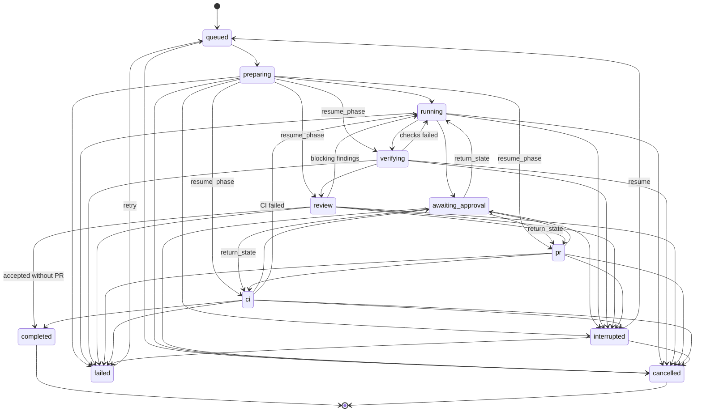

# Task and Session state machines

Status: Proposed with [ADR-0003](../decisions/0003-task-session-event-contracts.md).
The machine-readable source of truth is [`transitions.json`](transitions.json); the tables below mirror it. If they disagree, `transitions.json` wins and this file is a bug.

## Rules that apply to every transition

- **Only listed transitions are legal.** Anything else is rejected by the orchestrator (and by `validate_fixtures.py`).
- **The agent never changes task state.** ACP traffic is an *input* (actor `adapter`) that the orchestrator interprets. An agent message that says "approved" or "done" is text, not a transition.
- **Every transition is an event.** `task.state_changed` / `session.state_changed` (or `task.created` / `session.created` for the first state). The projection (`tasks.state`, `sessions.state`) is updated in the same SQLite transaction as the event append.
- **Durability** (see [checkpoint-and-replay.md](checkpoint-and-replay.md#durability-ordering)):
  - `persist_then_report`: commit the event before any subscriber, UI or agent observes the new state. No optimistic UI for durable state.
  - `persist_then_act`: commit the event *before* performing the side effect it authorizes (spawning a process, answering `session/request_permission`, starting an operation, sending `session/cancel`).
- **Actors**: `user` (a human action in AgentDock), `orchestrator` (workflow engine), `policy` (host approval gate), `adapter` (signal from an ACP agent process), `integration` (Git/GitHub/CI), `recovery` (startup crash recovery; may only move things *towards* a safe stop).

## Task states

| State | Meaning | Terminal? |
| --- | --- | --- |
| `queued` | Accepted, waiting for a concurrency slot. | no |
| `preparing` | Worktree, adapter process and session being set up (or re-established on resume). | no |
| `running` | An agent is implementing or repairing. The session may be idle waiting for the user. | no |
| `awaiting_approval` | Blocked on an approval. Returns to `approval.return_state` (`running`, `pr` or `ci`). | no |
| `verifying` | Local checks (tests, lint, build) are running or being evaluated. | no |
| `review` | Independent review (usually a child review session). | no |
| `pr` | Push / PR creation or update. All operations here are non-repeatable and approval-gated. | no |
| `ci` | Waiting on remote CI; merge (if any) is a separate approval-gated operation. | no |
| `completed` | Objective accepted. | yes |
| `interrupted` | Stopped by an external or user cause; can be resumed. Carries an `Interruption` record. | no |
| `failed` | The workflow cannot proceed without a human decision; can be retried. Carries a `Failure`. | no |
| `cancelled` | Stopped by the user for good. | yes |

`failed` is deliberately not terminal: "retry" (`T47`) is a user decision, never automatic.

**Paused** (mentioned in `architecture.md`) is not a separate state: it is `interrupted` with `reason = user_paused`. This keeps one resume path. See "Open questions" in the ADR.

### Task transitions

| ID | From | To | Actors | Triggers | Durability | Conditions |
| --- | --- | --- | --- | --- | --- | --- |
| T01 | `(new)` | `queued` | user | `task_created` | persist_then_report | — |
| T02 | `queued` | `preparing` | orchestrator | `scheduled` | persist_then_act | — |
| T03 | `queued` | `cancelled` | user | `user_cancel` | persist_then_report | — |
| T04 | `preparing` | `running` | orchestrator | `session_ready` | persist_then_report | — |
| T05 | `preparing` | `verifying` | orchestrator | `resume_phase_restored` | persist_then_report | `resume_phase_equals_to` |
| T06 | `preparing` | `review` | orchestrator | `resume_phase_restored` | persist_then_report | `resume_phase_equals_to` |
| T07 | `preparing` | `pr` | orchestrator | `resume_phase_restored` | persist_then_report | `resume_phase_equals_to`, `no_unreconciled_operations` |
| T08 | `preparing` | `ci` | orchestrator | `resume_phase_restored` | persist_then_report | `resume_phase_equals_to`, `no_unreconciled_operations` |
| T09 | `preparing` | `interrupted` | orchestrator, adapter, recovery | `interruption` | persist_then_report | — |
| T10 | `preparing` | `failed` | orchestrator | `preparation_failed` | persist_then_report | — |
| T11 | `preparing` | `cancelled` | user | `user_cancel` | persist_then_act | — |
| T12 | `running` | `awaiting_approval` | policy, adapter | `approval_requested` | persist_then_act | `approval_requested_before` |
| T13 | `running` | `verifying` | orchestrator, user | `implementation_done` | persist_then_report | — |
| T14 | `running` | `interrupted` | user, orchestrator, adapter, recovery | `interruption` | persist_then_report | — |
| T15 | `running` | `failed` | orchestrator, policy | `unrecoverable_error` | persist_then_report | — |
| T16 | `running` | `cancelled` | user | `user_cancel` | persist_then_act | — |
| T17 | `awaiting_approval` | `running` | user, policy | `approval_resolved` | persist_then_act | `return_state_matches`, `approval_resolved_before` |
| T18 | `awaiting_approval` | `pr` | user, policy | `approval_resolved` | persist_then_act | `return_state_matches`, `approval_resolved_before` |
| T19 | `awaiting_approval` | `ci` | user, policy | `approval_resolved` | persist_then_act | `return_state_matches`, `approval_resolved_before` |
| T20 | `awaiting_approval` | `interrupted` | user, orchestrator, adapter, recovery | `interruption` | persist_then_report | `approval_not_pending_after` |
| T21 | `awaiting_approval` | `cancelled` | user | `user_cancel` | persist_then_act | `approval_not_pending_after` |
| T22 | `verifying` | `running` | orchestrator | `checks_failed` | persist_then_report | — |
| T23 | `verifying` | `review` | orchestrator | `checks_passed` | persist_then_report | `local_checks_passed` |
| T24 | `verifying` | `interrupted` | user, orchestrator, recovery | `interruption` | persist_then_report | — |
| T25 | `verifying` | `failed` | orchestrator | `repair_limit_reached` | persist_then_report | — |
| T26 | `verifying` | `cancelled` | user | `user_cancel` | persist_then_act | — |
| T27 | `review` | `running` | orchestrator | `review_blocking_findings` | persist_then_report | — |
| T28 | `review` | `pr` | user, orchestrator | `review_passed` | persist_then_report | — |
| T29 | `review` | `completed` | user | `accepted_without_pr` | persist_then_report | — |
| T30 | `review` | `interrupted` | user, orchestrator, adapter, recovery | `interruption` | persist_then_report | — |
| T31 | `review` | `failed` | orchestrator | `repair_limit_reached` | persist_then_report | — |
| T32 | `review` | `cancelled` | user | `user_cancel` | persist_then_act | — |
| T33 | `pr` | `awaiting_approval` | policy | `approval_requested` | persist_then_act | `approval_requested_before` |
| T34 | `pr` | `ci` | integration | `pr_published` | persist_then_report | `pr_operation_succeeded` |
| T35 | `pr` | `interrupted` | user, orchestrator, integration, recovery | `interruption` | persist_then_report | — |
| T36 | `pr` | `failed` | integration, orchestrator | `operation_failed` | persist_then_report | — |
| T37 | `pr` | `cancelled` | user | `user_cancel` | persist_then_act | — |
| T38 | `ci` | `running` | orchestrator | `ci_failed` | persist_then_report | — |
| T39 | `ci` | `completed` | user, integration | `ci_passed_accepted` | persist_then_report | `ci_checks_passed` |
| T40 | `ci` | `awaiting_approval` | policy | `approval_requested` | persist_then_act | `approval_requested_before` |
| T41 | `ci` | `interrupted` | user, orchestrator, integration, recovery | `interruption` | persist_then_report | — |
| T42 | `ci` | `failed` | orchestrator | `repair_limit_reached` | persist_then_report | — |
| T43 | `ci` | `cancelled` | user | `user_cancel` | persist_then_act | — |
| T44 | `interrupted` | `queued` | user, orchestrator | `resume_requested`, `scheduled_resume` | persist_then_act | `orchestrator_only_if_auto_resume_armed_and_due` |
| T45 | `interrupted` | `failed` | user, orchestrator | `abandoned` | persist_then_report | — |
| T46 | `interrupted` | `cancelled` | user | `user_cancel` | persist_then_report | — |
| T47 | `failed` | `queued` | user | `retry_requested` | persist_then_act | — |

`T39` with actor `integration` covers "the PR was merged by a human on GitHub and CI is green"; AgentDock's own `pr_merge` is an approval-gated operation inside `ci` (`T40`/`T19`), never automatic.

### Conditions

| Condition | Meaning |
| --- | --- |
| `resume_phase_equals_to` | `payload.resume_phase == to`, and equals the `resume_phase` recorded when the task left `interrupted` (`T44` requires `resume_phase`). |
| `no_unreconciled_operations` | No operation of the task is `recorded`, `started` or `outcome_unknown`. Re-entering `pr`/`ci` after a crash requires reconciliation first. |
| `approval_requested_before` | The referenced approval was already persisted as `pending`. |
| `return_state_matches` | `to` equals the `return_state` recorded when the task entered `awaiting_approval` (which is always the state it left). |
| `approval_resolved_before` | The approval's resolution event is already persisted. |
| `approval_not_pending_after` | No approval of this task (for `S15`: of this session) is still `pending`. Resolve them first (`cancelled` on user cancel, `invalidated` by recovery) in the same transaction. |
| `local_checks_passed` | At least one `local` check started since the task last entered `verifying`, and all of them `passed`. An approval detour does not reset the phase. |
| `ci_checks_passed` | Same, for `ci` checks since the task last entered `ci`. |
| `pr_operation_succeeded` | A `pr_create` or `pr_update` operation of this task is `succeeded` or `reconciled_applied`. |
| `orchestrator_only_if_auto_resume_armed_and_due` | A user may resume any time (`resume_requested`). The orchestrator may resume only with `scheduled_resume`, only if `interruption.auto_resume_armed` is true, and not before `retry_hint.not_before`. |
| `launch_method_advertised` | A capability snapshot was recorded for *this* launch, and it advertises the launch method used (`load` → `load_session`, `resume` → `resume_session`). |
| `reattach_capability_required` | The last snapshot for the session advertises the requested method and an `external_session_id` is known. |

## Session states

A Session is one conversation with one ACP agent process lineage. A Task has many Sessions (implementation, review, repair, explore). Sessions can have a `parent_session_id` (a "main" session with child sessions).

| State | Meaning |
| --- | --- |
| `starting` | Process spawned / `initialize` / `session/new`, `session/load` or `session/resume` in flight. |
| `idle` | Ready, no turn in progress (may be waiting for the user). |
| `active` | A `session/prompt` turn is in progress. |
| `awaiting_permission` | The agent sent `session/request_permission`; AgentDock has not answered. |
| `suspended` | The task was interrupted (quota, pause); the process may still be alive. |
| `disconnected` | The process is gone (exited, crashed, host crashed). The external session may or may not be reattachable. |
| `closed` | Finished; carries `outcome` (`succeeded`, `failed`, `cancelled`, `superseded`, `abandoned`). |
| `failed` | Could not start or broke the protocol; carries `outcome`. |

`closed` and `failed` are terminal for that `session_id`. A task-level restart creates a **new** Session with `supersedes_session_id`.

### Session transitions

| ID | From | To | Actors | Triggers | Durability | Conditions |
| --- | --- | --- | --- | --- | --- | --- |
| S01 | `(new)` | `starting` | orchestrator | `launch` | persist_then_act | — |
| S02 | `starting` | `idle` | adapter | `session_ready` | persist_then_report | `launch_method_advertised` |
| S03 | `starting` | `failed` | adapter, orchestrator | `launch_failed`, `attach_rejected` | persist_then_report | — |
| S04 | `starting` | `disconnected` | adapter, recovery | `process_exited`, `host_recovery` | persist_then_report | — |
| S05 | `idle` | `active` | user, orchestrator | `prompt_submitted` | persist_then_act | — |
| S06 | `idle` | `closed` | user, orchestrator | `session_closed` | persist_then_act | — |
| S07 | `idle` | `suspended` | user, orchestrator | `task_interrupted` | persist_then_report | — |
| S08 | `idle` | `disconnected` | adapter, recovery | `process_exited`, `host_recovery` | persist_then_report | — |
| S09 | `active` | `idle` | adapter | `turn_ended` | persist_then_report | — |
| S10 | `active` | `awaiting_permission` | adapter | `permission_requested` | persist_then_act | — |
| S11 | `active` | `suspended` | user, orchestrator, adapter | `task_interrupted` | persist_then_report | — |
| S12 | `active` | `disconnected` | adapter, recovery | `process_exited`, `host_recovery` | persist_then_report | — |
| S13 | `active` | `failed` | adapter, orchestrator | `protocol_error` | persist_then_report | — |
| S14 | `awaiting_permission` | `active` | user, policy | `permission_resolved` | persist_then_act | `approval_resolved_before` |
| S15 | `awaiting_permission` | `idle` | adapter | `turn_ended` | persist_then_report | `approval_not_pending_after` |
| S16 | `awaiting_permission` | `disconnected` | adapter, recovery | `process_exited`, `host_recovery` | persist_then_report | — |
| S17 | `suspended` | `active` | user, orchestrator | `continue_prompt` | persist_then_act | — |
| S18 | `suspended` | `closed` | user, orchestrator | `superseded`, `session_closed` | persist_then_act | — |
| S19 | `suspended` | `disconnected` | adapter, recovery | `process_exited`, `host_recovery` | persist_then_report | — |
| S20 | `disconnected` | `starting` | orchestrator | `reattach_attempt` | persist_then_act | `reattach_capability_required` |
| S21 | `disconnected` | `closed` | user, orchestrator | `abandoned`, `superseded` | persist_then_report | — |

Additional session rules:

- `S05`/`S17` require a `session.prompt_submitted` with the same `turn_id` first.
- `S09`/`S15` carry the ACP v1 `stopReason` verbatim (`end_turn`, `max_tokens`, `max_turn_requests`, `refusal`, `cancelled`).
- `S10` requires the ACP permission to be persisted as a pending `Approval` first (`persist_then_act`: AgentDock must be able to show it after a crash).
- When a turn is cancelled, every pending `session/request_permission` is answered `cancelled` (ACP v1 requirement) and recorded as `approval.resolved{state: cancelled}` before the session leaves `awaiting_permission`.

## Collapsing child sessions

- A session may be collapsed by the user at any time (`session.collapsed{by: user}`).
- **Automatic** collapse (`by: auto`) is allowed only when the session has a `parent_session_id`, is `closed`/`failed`, **and** the user acknowledged its result (`session.result_acknowledged`) after it closed.
- A session without a parent (the main session) is never auto-collapsed.
