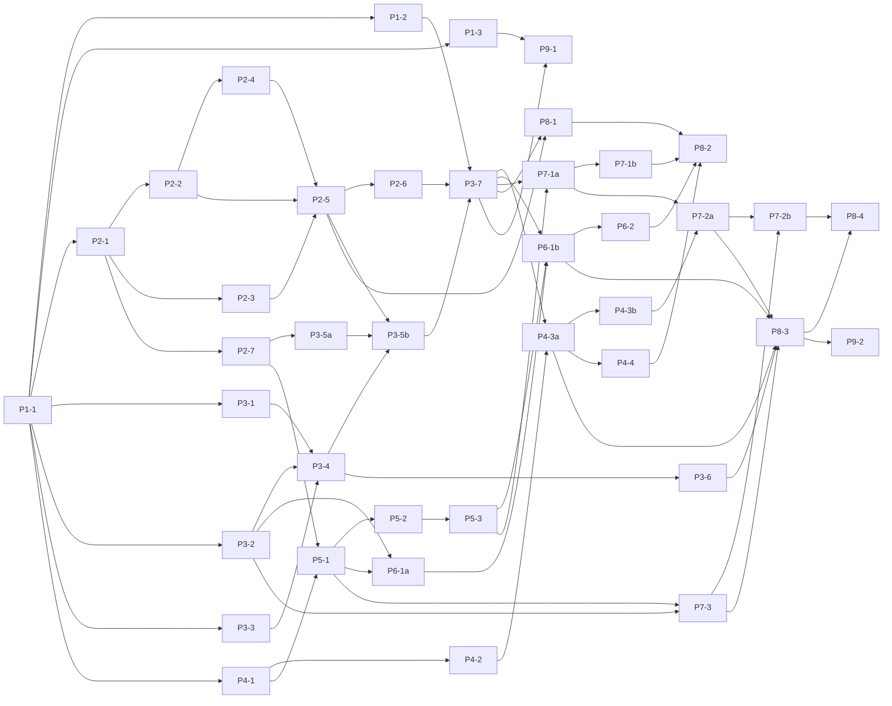

# AgentDock alpha task packets

> **繁中摘要**：這裡是 v0.1.0-alpha（P1–P9）的實作任務包，目標是讓能力較弱的模型（通常是透過 MCP 操作擁有者 Linux VM 的模型）照著做就能一次完成，再由 Codex／Claude Code 依每包的 §12 檢查清單 review。先讀 [CONVENTIONS.md](CONVENTIONS.md)（共用規則、12 節格式、Linux 前置套件、Windows CI 判讀）與 [ADR-0004](../decisions/0004-rust-primary-backend.md)（後端全 Rust、Node PR 只當行為參考）。本檔列出：任務包總覽與模型等級、依賴圖與平行化建議、#51 alpha gate 對照、尚未涵蓋的項目、待擁有者決定的問題、既有文件問題，以及 V1 待寫清單。行號一律以 main `c9e33cf` 為準。

Status: Proposed. Date: 2026-11-22. Scope: alpha only (issue #51 gates). Line numbers in every packet refer to main `c9e33cf` unless stated otherwise.

## How to use

1. Read [CONVENTIONS.md](CONVENTIONS.md) first: fixed 12-section format, repo layout, safety invariants, Linux prerequisites (ask the owner before installing system packages), how to read Windows CI results.
2. Pick a packet whose prerequisites are merged (see the graph below). One packet (or named sub-PR such as P3-5a) = one PR.
3. Implement test-first; run every §7 command yourself. Windows-only items are satisfied only by a passing `windows-latest` job that actually ran the named test.
4. Reviewers (Codex / Claude Code) use the packet's §12 checklist plus CONVENTIONS §6 invariants.
5. If a packet contradicts an ADR or contract, the ADR/contract wins; write the contradiction in the PR.

## Packet index

Tier: **S** = standard model is enough; **S/R** = standard model implements, strong model reviews; **St** = strong model implements and reviews.

| Packet | Title | Issues | Gates | Tier |
| --- | --- | --- | --- | --- |
| [P1-1](P1-1-cargo-workspace.md) | Cargo workspace, toolchain, lints | #4 | G1 | S |
| [P1-2](P1-2-tauri-shell-ipc.md) | Tauri 2 shell, CSP, capability, typed IPC | #4 | G1 | S (CSP/capability reviewed once by strong) |
| [P1-3](P1-3-windows-ci.md) | Rust CI on Linux and Windows, cargo-deny | #4, #41, #55 | G1 | S |
| [P2-1](P2-1-core-ids-envelope.md) | Core IDs, enums, canonical hash, envelope | #7, #3 | G3 | S |
| [P2-2](P2-2-core-payloads.md) | Typed payloads and schema rules | #7, #3 | G3 | S (rule table reviewed by strong) |
| [P2-3](P2-3-state-machine-guards.md) | Task/session state machines | #7, #3 | G3, G8 | S/R |
| [P2-4](P2-4-sqlite-event-store.md) | SQLite event store | #7 | G3, G8 | St |
| [P2-5](P2-5-projections-conformance.md) | Projections, invariants, fixture conformance | #7, #3, #8 | G3, G7, G8 | St |
| [P2-6](P2-6-crash-recovery.md) | Startup crash recovery | #7, #8 | G3, G8 | St |
| [P2-7](P2-7-redaction-bounds.md) | Redaction and length bounds | #7, #8 | G3, G2 | S (rule table reviewed by strong) |
| [P3-1](P3-1-acp-line-framing.md) | ACP crate, line framing, spike S1 | #6 | G2 | S |
| [P3-2](P3-2-process-supervisor-windows.md) | Process supervision (Job Object / process group) | #6, #8 | G2, G8 | St |
| [P3-3](P3-3-mock-acp-agent.md) | Mock ACP agent | #6 | G2, G8 | S |
| [P3-4](P3-4-acp-client-facade.md) | ACP client facade | #6 | G2 | St |
| [P3-5](P3-5-session-runtime.md) | Session runtime (a: output governance, b: runtime) | #6, #7 | G2, G3 | a: S; b: St |
| [P3-6](P3-6-adapter-registry-real-agents.md) | Adapter config, Claude/Codex, opt-in E2E | #6, #42 | G2 | S (E2E by a human) |
| [P3-7](P3-7-desktop-app-state.md) | Desktop app state, recovery before commands | #14, #15 | G1, G3, G8 | S/R |
| [P4-1](P4-1-workspace-path-scope.md) | Workspace path scope | #8 | G7 | St |
| [P4-2](P4-2-operation-classification.md) | Operation classification | #8 | G7 | St |
| [P4-3](P4-3-approval-engine.md) | Approval engine (a: ACP permissions, b: `execute_guarded`) | #8, #10 | G5, G7, G8 | St |
| [P4-4](P4-4-approval-ui.md) | Approval UI | #8, #9 | G5, G7 | S |
| [P5-1](P5-1-git-cli-wrapper.md) | Git CLI wrapper | #9 | G4, G5 | S |
| [P5-2](P5-2-worktree-create.md) | Create task worktree | #9 | G4 | St |
| [P5-3](P5-3-worktree-reconcile-scope.md) | Worktree probe and per-task scope | #9, #8 | G4, G7, G3 | St |
| [P6-1](P6-1-check-runner.md) | Controlled check runner (a: runner, b: events) | #10, #47 | G6, G8 | a: S; b: S/R |
| [P6-2](P6-2-check-ui.md) | Checks tab | #10, #2 | G6 | S |
| [P7-1](P7-1-git-status-diff.md) | Git status and diff (a: backend, b: Changes tab) | #9, #2 | G5 | S |
| [P7-2](P7-2-commit-push-pr.md) | Commit, push, create PR (a: commit/push, b: PR) | #10, #9, #8 | G5, G7, G8 | St |
| [P7-3](P7-3-github-readonly-evidence.md) | GitHub CLI wrapper, read-only evidence | #10, #15 | G5, G6 | S/R |
| [P8-1](P8-1-attention.md) | Attention items | #7, #36, #15 | G3, G8 | S |
| [P8-2](P8-2-sentinel-ui.md) | Session Sentinel UI | #7, #36, #2 | G3, G8 | S |
| [P8-3](P8-3-orchestrator-local-phases.md) | Orchestrator, local phases | #10, #9, #6, #15 | G2, G3, G4, G6, G8 | St |
| [P8-4](P8-4-pr-ci-gates.md) | PR and CI phases, no merge | #10, #15 | G5, G6, G8 | St |
| [P9-1](P9-1-release-packaging.md) | v0.1.0-alpha release packaging | #51, #41, #55 | G1, G9 | S |
| [P9-2](P9-2-alpha-dogfood-log.md) | Alpha dogfood log | #51 | G8, self-hosting | S |

Honest note on tiers: "S" means the packet's rules are fully tabulated, not that the area is trivial. Every packet touching process lifetime, event ordering, approvals or Git writes is **St**; do not downgrade it to save cost.

## Dependency graph

Arrows point from prerequisite to dependent. Sub-PRs (a/b) are shown where they matter.

The graph shows the main edges; each packet's §2 is authoritative (some list extra prerequisites such as P2-2 payload types).

## Parallelization

Waves of packets that can be worked on at the same time once the previous wave is merged. Within a wave, packets touch different crates or files; where two touch the same frontend files (`App.tsx`, `messages.ts`), the later PR resolves adjacent-line conflicts only.

| Wave | Packets | Notes |
| --- | --- | --- |
| 1 | P1-1 | everything depends on the workspace |
| 2 | P1-2, P1-3, P2-1, P3-1, P3-2, P3-3, P4-1 | seven independent tracks |
| 3 | P2-2, P2-3, P2-7, P3-4 (after P3-1..3), P4-2 | |
| 4 | P2-4, P3-5a, P3-6, P5-1 | P5-1 needs P2-7 |
| 5 | P2-5, P5-2, P6-1a, P7-3 | P2-5 is the bottleneck for the store side |
| 6 | P2-6, P3-5b, P5-3 | |
| 7 | P3-7 | joins store, recovery and runtime in the desktop app |
| 8 | P4-3a, P6-1b, P7-1a, P8-1 | |
| 9 | P4-3b, P4-4, P6-2, P7-1b | |
| 10 | P7-2a, P8-2 (partial) | |
| 11 | P7-2b, P8-3a | |
| 12 | P8-3b, P8-4, P9-2 | |
| 13 | P9-1 (workflow can land earlier; release after P8) | |

Critical path: P1-1 → P2-1 → P2-2 → P2-4 → P2-5 → P2-6 → P3-7 → P4-3a → P4-3b → P7-2a → P7-2b → P8-4 → P9-1. Strong-model capacity should go here first.

## Issue #51 gate tracking

Gate numbering used in every packet header. "Proven by" lists the packets whose tests or manual steps produce the evidence; a gate is met only when all of them are merged **and** the owner's dogfood (P9-2) confirms it on a real repository.

| Gate | Meaning (summary of #51) | Proven by | Status |
| --- | --- | --- | --- |
| G1 | Reproducible build; install, start, close, reopen | P1-1, P1-2, P1-3, P3-7, P9-1 | not started |
| G2 | Real agents (Claude Code, Codex) through ACP: session, prompt, stream, cancel | P3-1..P3-6, P8-3 | not started |
| G3 | Event log persists; real state after interruption and reopen | P2-1..P2-7, P3-5, P3-7, P5-3, P8-1, P8-2, P8-3 | not started |
| G4 | Each task in its own worktree; two tasks in parallel without interference | P5-1, P5-2, P5-3, P8-3 | not started |
| G5 | Git status/diff shown; commits; human confirmation before PR | P4-3, P4-4, P5-1, P7-1, P7-2, P7-3, P8-4 | not started |
| G6 | Controlled runner runs tests; PASS/FAIL/BLOCKED with logs; no agent self-reported PASS; real CI evidence | P6-1, P6-2, P7-3, P8-3, P8-4 | not started |
| G7 | Host policy and path escape: denied operations never run; no cross-task access | P2-5, P4-1, P4-2, P4-3, P4-4, P5-3, P7-2 | not started |
| G8 | 10 real tasks with the required mix; recovery without data loss; no orphan processes | P2-3, P2-4, P2-6, P3-2, P3-3, P6-1, P8-*, P9-2 | not started |
| G9 | Release: traceable commit, release notes, known limits, installer checksum | P9-1 | not started |

## Not yet covered (alpha gaps, intentionally out of these packets)

- Nested Job Objects and CPU/priority caps for agent processes (ADR-0002 line 37).
- Unix parent-death handling (`PR_SET_PDEATHSIG`): on Linux a SIGKILLed AgentDock does not take the agent's process group down (P3-2 known gap).
- Agents running inside WSL; WSL path interop (ADR-0002 WT-11).
- TOCTOU between path check and use: re-check before use mitigates it; handle-level protection is not implemented (P4-1).
- Detecting working-tree content changes during a check run (only HEAD is compared; P6-1).
- Transcript compaction and retention; session reattach (S20).
- Worktree removal (#37) and branch cleanup.
- Detecting agents' native bypass/"yolo" modes (#26).
- ACP `fs/*` and `terminal/*` client capabilities (not advertised in alpha).
- Task deletion and tombstones.
- Automatic resume after crash (alpha shows state; the user resumes).
- "Mark all as read" in the Sentinel inbox.
- `.gitattributes` for line endings in the repo itself.
- Check settings screen and policy rule settings screen (alpha uses hand-written JSON in app data).

## Open questions for the owner

Packets pick a default so work is not blocked; each needs confirmation.

1. **ACP permission TTL**: packets default to 10 minutes (P4-3); PR #25 used 90 s.
2. **Crash during recovery** (bracket left open): the contract does not define it; P2-6 continues inside the open bracket and writes one `system.recovery_completed` covering both runs.
3. **Disabling repo hooks** for AgentDock's own Git commands (P5-1 `core.hooksPath` → empty dir): safer, but the user's pre-commit hooks do not run on AgentDock commits.
4. **Approvals after restart**: the contract invalidates pending approvals (`checkpoint-and-replay.md` crash recovery step 3); UX-62 and F2 Rules say they are restored as pending. Packets follow the contract (P2-6, P4-4).
5. **UX F5 step 4** ("pending approvals are restored as pending", `docs/ux/flows.md` lines 55–61) conflicts with the same contract rule.
6. **Output limits** 8 MiB / 20,000 events per turn (ADR-0003 open question 6; P3-5).
7. **Tauri `identifier`** `dev.agentdock.desktop` is provisional; it fixes the app data path (P1-2).
8. **Repos without CI**: `NoChecks` cannot complete through the PR path; P8-4 shows a message and makes no transition.
9. **Code signing** for the installer (P9-1 ships unsigned).
10. **Quota-name deny-list** in payloads (P2-2) — confirm the word list (`remaining`, `_left`, `balance`, `allowance`, `percent`, `pct`, `quota` …).
11. **ADR-0004 open questions** 1–3: keep `validate_fixtures.py` in CI; ADR-0003's 12 states vs PR #29's 16; frontend/backend type sync approach.
12. **Unix PDEATHSIG gap** (see "Not yet covered"): accept for alpha or add a packet.
13. **ADR-0003 open questions the packets assume**: Q3 `auto_resume_policy` both off (P8-3 never arms auto-resume); Q7 policy may approve `pr_create`/`pr_update`/`pr_comment`/`external_write`, and `git_push` only through a user-created rule (P4-3); Q8/Q14 one pending permission per task/session, later requests are held in a FIFO (P4-3).
14. **Node reference PRs are not drafts**: #25, #27, #28, #29, #33 are open and not marked draft on GitHub (checked 2026-11-22). ADR-0004 treats them as "open, never merged, reference only"; converting them to draft is the owner's call.
15. **Interruption reasons** (P8-3): an agent that exits on its own → `adapter_disconnected` (actor adapter); a protocol error or oversized line → `session_unavailable` (actor orchestrator, `acp-capabilities.md` line 97). A user pause while `preparing` is written by `orchestrator`, because T09 does not allow actor `user`.
16. **ACP permission requests while the task is in `pr` / `ci`** (P4-3): T33/T40 allow only actor `policy`, so such requests are answered `cancelled` and nothing is recorded (only a `tracing` warning).
17. **Host-initiated session close** (P3-5 §5 step 9): waits up to 10 s for the turn to end after `session/cancel`; if the agent never ends it, the session is closed via S11 → S18 (active) or killed and recorded as S16 → S21 (awaiting permission).

## Existing document issues

Found while writing the packets; not fixed here (ADRs and contracts are not edited by packets).

- ADR-0002 §3 says `pnpm audit`; the repo uses npm (`package-lock.json`). Packets use `npm audit`.
- UX-62 / F2 Rules / F5 step 4 vs `checkpoint-and-replay.md` crash recovery step 3 on pending approvals (see open questions 4–5).
- ADR-0002 lines 52 and 99 pin `agent-client-protocol =5.3.0` pending #504; crates.io has `5.5.1` and `v5.4.0+` contain #504 (checked 2026-11-22; see ADR-0004). The pin is chosen in P3-1.
- PR #29's 16-state workflow doc differs from ADR-0003's 12 states (ADR-0004 open question 2).
- `checkpoint-and-replay.md` line 54 says recovery writes "one transaction per entity", while line 65 says the completed list is written "in the recovery transaction" (singular). P2-6 follows line 54.
- `operation.failed{effect: unknown}` is a dead end in the contract: it can be neither reconciled (`validate_fixtures.py` line 1063 accepts only `outcome_unknown`) nor superseded (lines 969–971). Packets therefore never write it: every effect with an unknown result is `outcome_unknown{cause: killed}` (P4-3b `EffectOutcome::Unknown`, P7-2).

## V1 packets still to write (after alpha)

Not written yet; listed so the scope is visible.

- Worktree removal and branch cleanup with approval (#37; WT-5, WT-6).
- `pr_update`, `pr_comment` and user-approved `pr_merge` execution (merge stays user-only).
- Bypass-mode detection and indicator (#26, UX F8 / §9).
- Policy rules settings screen and check settings screen.
- Event-stream subscription replacing all polling (generic; P8-2 covers the first part).
- Transcript compaction, retention and export.
- Session reattach (S20) and automatic resume policy.
- ACP `fs/*` / `terminal/*` capabilities with Rust-side scope enforcement.
- OS-level sandbox for agents (#62).
- Nested job / CPU caps; Unix parent-death handling.
- Code signing and auto-update; MSI / winget.
- Remote or cached check execution (#47, #48).
- Inline review comments (UX-66).
- Multi-repo / fork push support.
