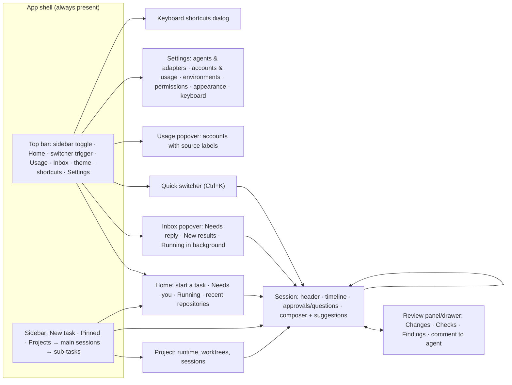

# Information architecture and screen map

Status: Draft for issue #2. Terms follow `docs/architecture.md` (`Project`, `Task`, `Session`, `Event`, `Approval`, `Check`, `Usage`).

## 1. Objects the user sees

| UI term | Domain object | Notes |
| --- | --- | --- |
| Repository / project | `Project` | A local Git repository (or a remote path on a worker). Grouping key in the sidebar. |
| Task | `Task` | One objective with one worktree and branch. The user mostly sees it through its **main session**. |
| Main session | first `Session` of a `Task` | The conversation the user steers. Never auto-archived; new instructions can be added at any time. |
| Sub-task | additional `Session`s of the same `Task` (implementation helpers, explorer, tester, independent reviewer) | Shown nested under the main session as **background agents**. Auto-archive after their result has been opened and the user moves on (see [states-and-indicators.md §5](states-and-indicators.md#5-main-sessions-sub-tasks-and-archiving)). |
| Change set | worktree diff vs base branch | Shown in the review panel; never edited in place (no IDE). |
| Check | `Check` | Evidence from commands the workbench ran; agent prose is not evidence. |
| Approval | `Approval` | A blocking decision with operation, scope, rule and result. |
| Account | adapter/provider identity + `Usage` | Shown in the usage popover with a source label. |

## 2. Screen map

Mobile/narrow mapping (future Android client, not MVP): see §6.

## 3. Regions of the shell

| Region | Contents | Landmark | Notes |
| --- | --- | --- | --- |
| Top bar | sidebar toggle, brand (→ Home), **switcher trigger** (“Switch session or search… Ctrl K”), Usage button, **Inbox** button, theme, shortcuts, Settings | `header` | Always visible, also when the sidebar is collapsed — the inbox is reachable without the sidebar. |
| Sidebar | New task; **Pinned** group; one group per project; main sessions; nested sub-tasks; “Show N archived” toggles; “N archived — search with Ctrl+K” per project | `nav` with an ARIA `tree` | Resizable 220–400 px; collapsible (Ctrl+B); drawer below 960 px. |
| Main | Home, Project, Session or Settings view | `main` | Session view is the default after launch (last session). |
| Review panel | Changes / Checks / Findings tabs, diff, comment-to-agent | `aside` | Docked at ≥ 1280 px; overlay drawer below. |
| Overlays | Inbox popover, Usage popover, Quick switcher, shortcuts dialog, toasts | — | One popover or modal drawer at a time (a new one replaces the old one); a dialog may open above a drawer; see [accessibility.md](accessibility.md#overlays--one-at-a-time). |

## 4. Screens

### Home
Purpose: start work and see what needs you across all projects.
- **Start a task**: recent repositories as cards (path, branch, clean/dirty, default agent). Choosing one reveals the task box with the defaults: default agent, *new worktree from the base branch*, local/remote. Enter starts. “Paste a GitHub Issue URL” is accepted in the same box (V1.0).
- **Needs you**: union of Needs reply + New results (same model as the inbox).
- **Running**: background, local and remote work.
- Later sections: recent failures, resumable/interrupted work.

### Project
Repository metadata (path, base branch, dirty files), **runtime selection** (default agent, local vs remote target), **worktrees** table (path, branch, sessions, state; cleanup requires explicit confirmation, V1.0), sessions list (including sub-tasks).

### Session
- **Header**: breadcrumb (project / branch · worktree · “Sub-task of …” link), title, chips (status, kind, agent + model *as reported by the adapter*, “Policy not enforced” or “Policy coverage unknown” when they apply, “Archived” when archived), actions (**Unarchive** when archived, Stop while running, **Changes +a −d** toggles the review panel).
- **Policy note**: only while the agent runs in its own bypass / full-access mode — a persistent, non-dismissible note under the header saying that AgentDock’s approval rules do not apply to what the agent does ([states §9](states-and-indicators.md#9-policy-enforcement-indicator-agent-bypass--full-access-modes)).
- **Sticky attention banner**: only while a pending approval/question card is scrolled out of view; “Show” scrolls to and focuses the card (not its Approve button). The banner is only a pointer: its one-line text may be truncated (full text in a tooltip); the **full command is shown only in the approval card**, which is what the user approves.
- **Timeline** (`role="log"`): user messages, agent text, plan card, collapsible tool events (collapsed by default, output in monospace), approval cards, question cards, notices (interrupted, quota, remote, cancelled), completion card with “Review changes · N files +a −d” and check summary.
- **Composer**: suggestion chips (“Suggested next”), ghost text for the first suggestion, Tab or → inserts it (only when the composer is empty and the ghost is visible), Enter sends / steers while running, Stop (placed after Send/Steer in focus order). Drafts are kept per session.

### Review panel / drawer
Header: worktree vs base, file count, `+a −d`. Tabs: **Changes** (file list with status letter A/M/D/R + counts → diff), **Checks** (commands the workbench ran, pass/fail with text), **Findings** (reviewer output tagged *Blocking* / *Suggestion*). Footer: “Comment to the agent” → posts into the session. No auto-push, no merge buttons in MVP; PR/CI rows appear in V1.0.

### Inbox (top bar)
See [states-and-indicators.md §4](states-and-indicators.md#4-attention-model-inbox-badge-switcher-ordering).

### Quick switcher (Ctrl+K)
- Empty query: groups in this order — **Needs your reply**, **Recent** (this window’s most-recently-used, up to 6), **New results**, **Pinned**, **Running**. Each session appears once (highest group wins); the session on screen is omitted.
- With a query: fuzzy match on title and project name (grapheme-aware, NFC-normalised, case-insensitive; each whitespace token must match; title matches weigh 1.5×; contiguous and word-start matches rank higher; archived sessions included but ranked ×0.6 and tagged). At most 100 rows, then “N more not shown — refine the query”.
- Later: “Search inside transcripts” row hands the query to transcript search (not MVP).

### Usage popover (top bar)
See [states-and-indicators.md §8](states-and-indicators.md#8-usage-display-rules-connected-accounts).

### Settings
Sections: **Agents & adapters** (detected/installed, version, capability snapshot: session reattach advertised or not, cancel support, whether the adapter reports its permission mode), **Accounts & usage** (sources, refresh), **Environments** (WSL, SSH targets — V1.0), **Permissions** (approval rules; enforced in Rust), **Appearance** (theme system/light/dark, density, UI text size, reduced motion override), **Keyboard** (shortcut list; remapping later).

## 5. Navigation model — why there is no tab strip

A previous design used a row of session tab buttons; it became crowded with parallel sessions and gave every session equal weight. AgentDock instead uses four complementary paths, each optimised for one intent:

| Intent | Path | Cost |
| --- | --- | --- |
| “Go back to the one I just used / the 2–3 I live in” | **Pinned** group (Alt+1…9) and the switcher’s **Recent** group | 1 key chord |
| “Something needs me — where?” | **Inbox** badge → row, or **Ctrl+J** (next item needing you) | 1–2 actions |
| “I know roughly its name” | **Ctrl+K** fuzzy switcher | type 2–4 letters + Enter |
| “Browse by project / see the tree of sub-tasks” | **Sidebar** grouped by project, collapsible, with sub-task summaries | scroll/arrow keys |

The sidebar is a navigation tree, not a tab bar: it scales to dozens of sessions because projects collapse, sub-tasks nest and archive, and old sessions leave the tree but stay searchable.

**Pinned** sessions appear only in the Pinned group (with the project name as a suffix), not duplicated under their project, so arrow-key navigation never visits the same session twice. (Pending decision — see [README.md](README.md#decisions-for-the-owner).)

## 6. Future narrow/mobile mapping (not MVP)

The PRD excludes a mobile client from the MVP. The IA is chosen so a phone client (Android) can reuse it without new concepts:

| Desktop | Phone (future) |
| --- | --- |
| Inbox popover | **Primary tab** “Needs you” (same three sections, same badge semantics) |
| Pinned + Recent | Second tab “Sessions” (pinned on top) |
| Sidebar tree | Project filter inside “Sessions” |
| Session view | Full-screen session; approvals identical card; composer with suggestion chips |
| Review panel | Read-only summary (files, checks, findings); no diff editing |
| Status glyphs, kind glyphs, source labels | Identical vocabulary and accessible names |

The same status vocabulary and accessible names are therefore a contract, not desktop decoration.
