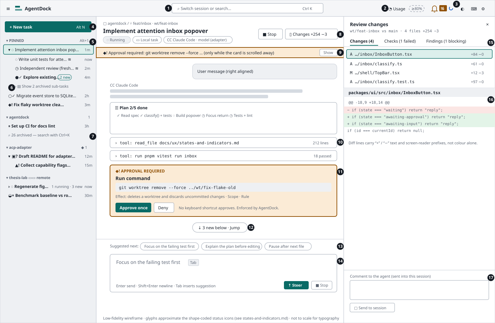
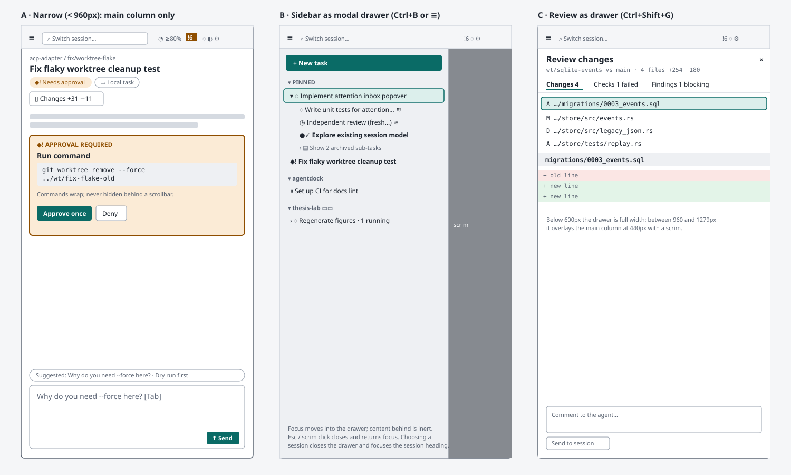

# Wireframes

Status: Draft for issue #2. Low-fidelity layout and behaviour. Visual detail lives in the [prototype](prototype/index.html) and [screenshots](screenshots/).

## 1. Desktop, 3 columns (≥ 1280 px)



| # | Element | Behaviour |
| --- | --- | --- |
| 1 | Switcher trigger “Switch session or search… Ctrl K” | Opens the quick switcher. Replaces a tab strip. |
| 2 | Usage | Popover with every connected account and its **source label**; “≥80%” text flag only for provider-reported values. |
| 3 | Inbox (bell + badge + background ring) | Square “!n” badge = something blocks an agent; round “n” = results to review; ring = background work (not counted). |
| 4 | New task | Opens Home with repository cards (Ctrl+N; Alt+N in the prototype). |
| 5 | Pinned group | Pinned main sessions across projects, Alt+1…9. |
| 6 | Sub-tasks + “Show N archived” | Background agents nested under their main session; viewed completed ones auto-archive. |
| 7 | “N archived — search with Ctrl+K” | Archived main sessions leave the tree but stay searchable. |
| 8 | Session header | Breadcrumb, title, status/kind/agent chips, Stop, **Changes +a −d**. |
| 9 | Sticky attention banner | Only while a pending approval/question card is scrolled away. A pointer only: it may truncate; the full command is shown only in the card. |
| 10 | Tool event cards | Collapsed by default; one line of result; expandable output. |
| 11 | Approval card | Operation, exact command (wraps), effect, scope, rule; Approve once / Deny; no shortcut. |
| 12 | Jump-to-latest pill | Appears when new events arrive while scrolled up; shows the count. |
| 13 | Suggested next prompts | Up to 3 chips; first one also shown as ghost text in the empty composer. |
| 14 | Composer | Enter send/steer, Shift+Enter newline, **Tab (or →) inserts the ghost suggestion** (only when empty), Stop while running — placed after Steer so the next Tab stop is never Stop. |
| 15 | Review tabs | Changes · Checks (n failed) · Findings (n blocking). |
| 16 | Diff | Unified diff; “+/−” sign column; file header sticky. |
| 17 | Comment to agent | Posts the review comment into the same session. |

### ASCII version (for quick diffs in review)

```text
┌──────────────────────────────────────────────────────────────────────────────────────────────────┐
│≡  ▬ AgentDock    [⌕ Switch session or search…  Ctrl K]    ◔ Usage ≥80%  [!6] ◌  ◐ ⌨ ⚙            │
├──────────────────────┬───────────────────────────────────────────────┬───────────────────────────┤
│[+ New task    Alt N] │agentdock / feat/inbox · wt/feat-inbox         │Review changes          ×  │
│▾ PINNED      Alt+1…3 │Implement attention inbox popover              │wt/feat-inbox vs main      │
│▌▾ ◌ Implement…    1m │(◌ Running) (▭ Local) (CC) [■ Stop] [▯ +254 −3]│Changes 4 │Checks│Findings │
│    ◌ Write tests…  ≋ │───────────────────────────────────────────────│A …/InboxButton.tsx   +84  │
│    ◷ Indep. review ≋ │◆! Approval required: git worktree… [Show]     │A …/classify.ts       +61  │
│    ●✓ Explore  2 new │                    ┌────────────────────────┐ │M …/TopBar.tsx     +12 −3  │
│    › ▤ 2 archived    │                    │ user message           │ │───────────────────────────│
│○✓ Migrate event…  2h │CC agent text …     └────────────────────────┘ │@@ -18,9 +18,14 @@         │
│◆! Fix flaky… (1 new) │┌ Plan 2/5 done ──────────────────────────────┐│− if (s === "waiting")     │
│▾ agentdock           │└─────────────────────────────────────────────┘│+ if (…"awaiting-approval")│
│⏸ Set up CI…  (1 new) │› tool read_file docs/ux/…          212 lines  │+ if (…"awaiting-input")   │
│⌕ 26 archived…        │┌ ◆! APPROVAL REQUIRED ───────────────────────┐│                           │
│▾ acp-adapter      ◆1 ││ Run command                                 ││                           │
│▾ ▣? Draft README…    ││ git worktree remove --force ../wt/fix-flake ││                           │
│    ▲! Collect caps…  ││ [Approve once] [Deny]                       ││                           │
│▾ thesis-lab  ▭▭      │└─────────────────────────────────────────────┘│                           │
│› ◌ Regenerate… 3 new │            ( ↓ 3 new below · Jump )           │Comment to the agent       │
│◒× Benchmark…     30m │Suggested next: (Focus on…) (Explain…) (…)     │[                       ]  │
│                      │┌─────────────────────────────────────────────┐│[Send to session]          │
│                      ││ Focus on the failing test first  [Tab]      ││                           │
│                      ││                         [↑ Steer] [■ Stop]  ││                           │
│                      │└─────────────────────────────────────────────┘│                           │
└──────────────────────┴───────────────────────────────────────────────┴───────────────────────────┘
Glyph key: ◌ running · ◷ queued · ◆! needs approval · ▣? needs reply · ●✓ done·new · ○✓ done
           ▲! failed · ◒× quota · ⏸ interrupted · ≋ background agent · ▭▭ remote · ▤ archived
```

## 2. Narrow window (< 960 px) with drawers



- **A — Main only.** Top bar condenses: switcher trigger shrinks to its icon + placeholder; Usage keeps the flag; inbox badge always visible.
- **B — Sidebar drawer** (≡ or Ctrl+B): slides from the left over a scrim; content behind is inert; Esc/scrim closes and restores focus; choosing a session closes the drawer and focuses the session heading.
- **C — Review drawer** (Ctrl+Shift+G or “Changes”): 440 px overlay from the right with a scrim between 600 and 1279 px; full width below 600 px.

```text
A: main only                     B: sidebar drawer                C: review drawer
┌─────────────────────────────┐  ┌─────────────────────────────┐  ┌─────────────────────────────┐
│≡ [⌕ Switch…] ≥80% [!6] ◌ ⚙  │  │≡ [⌕ Switch…]     [!6] ◌ ⚙   │  │≡ [⌕ Switch…]     [!6] ◌ ⚙   │
├─────────────────────────────┤  ├─────────────────────────────┤  ├─────────────────────────────┤
│acp-adapter / fix/…          │  │[+ New task]     │░░░░░░░░░░ │  │Review changes            ×  │
│Fix flaky worktree test      │  │▾ PINNED         │░░ scrim ░░│  │Changes 4 │Checks│Findings   │
│(◆! Needs approval)          │  │▌◌ Implement…    │░░ inert ░░│  │A …/0003_events.sql          │
│[▯ Changes +31 −11]          │  │   ◌ Write tests │░░░░░░░░░░ │  │M …/events.rs                │
│┌ ◆! APPROVAL REQUIRED ───┐  │  │◆! Fix flaky…    │░░░░░░░░░░ │  │D …/legacy_json.rs           │
││ git worktree remove     │  │  │▾ agentdock      │░░░░░░░░░░ │  │− old line                   │
││ --force ../wt/fix-flake │  │  │⏸ Set up CI…     │░░░░░░░░░░ │  │+ new line                   │
││ [Approve once] [Deny]   │  │  │                 │░░░░░░░░░░ │  │                             │
│└─────────────────────────┘  │  │Esc/scrim closes │░░░░░░░░░░ │  │Comment to the agent         │
│(Suggested: Why --force?)    │  │focus returns    │░░░░░░░░░░ │  │[                         ]  │
│[Why do you need… [Tab]]     │  │                 │░░░░░░░░░░ │  │[Send to session]            │
└─────────────────────────────┘  └─────────────────────────────┘  └─────────────────────────────┘
```

## 3. Breakpoint behaviour summary

| Width | Sidebar | Main | Review | Top bar |
| --- | --- | --- | --- | --- |
| ≥ 1280 | docked, resizable, collapsible (Ctrl+B) | flexible | docked column, resizable | full labels |
| 960–1279 | docked | flexible | **overlay drawer** 440 px + scrim | full labels |
| < 960 | **modal drawer** | full width | overlay drawer + scrim | switcher trigger without kbd hint; “Prototype” tag and Usage label hidden |
| < 600 | modal drawer (88 vw) | full width | **full-width** drawer | brand name, shortcuts button hidden (still in Ctrl+/ and settings) |

Drag-and-drop is intentionally not required in MVP; resizing the sidebar and review panel by dragging their edge (with keyboard alternative: Settings → Appearance widths, and Ctrl+B / Ctrl+Shift+G toggles) is the only layout manipulation. Re-ordering pinned sessions by drag is a later enhancement and must have a keyboard equivalent (“Move up/down” in the row menu).
